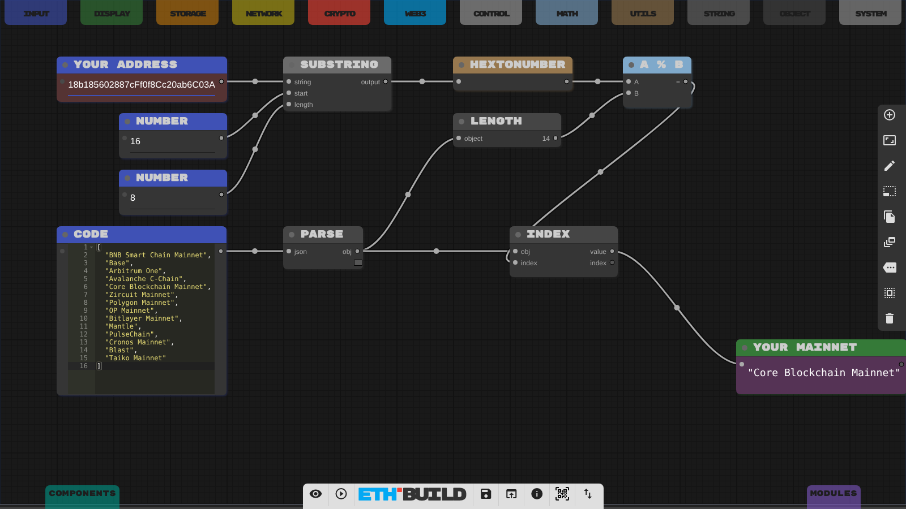
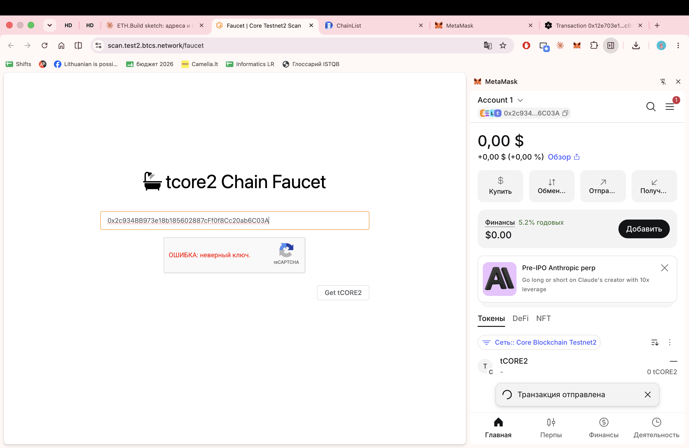
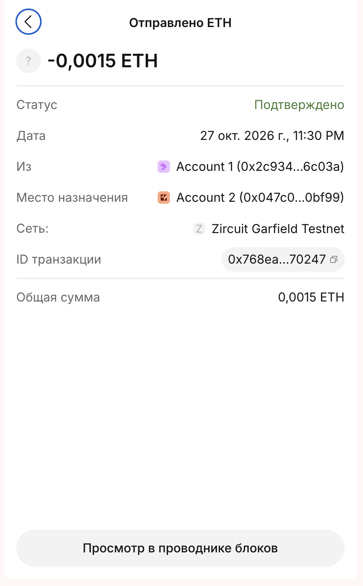
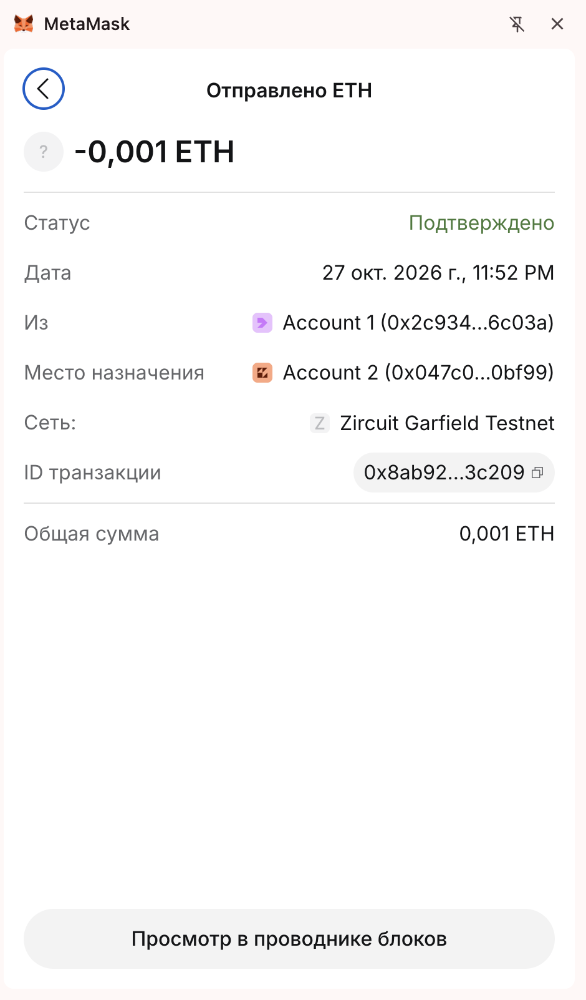

# Assignment 3: Blockchain basics (MetaMask, chains, transactions, gas, nonce)

- Name: Aliaksandra Yurenia
- Target blockchain for the address in Part 1 (ETH.Build sketch): Core
- Testnet actually used: Zircuit Garfield Testnet (chain ID 48898), see the note below

**Note about the chain.** My first MetaMask wallet (address 0xCA7978a03D83d59D000f67A5bFa6a6050c8200f1) gave Zircuit Mainnet in the sketch. I lost access to that wallet (it was created with a Google login and had no Secret Recovery Phrase), so I created a new wallet from a Secret Recovery Phrase. The address of the new wallet (Part 1) gives Core in the sketch. The official Core Testnet2 faucet (https://scan.test2.btcs.network/faucet) is broken: its reCAPTCHA shows an invalid site key error, so I could not get test tokens on Core. Because of that I did Parts 2, 3 and 5 on Zircuit Garfield Testnet, where I already had funds.

Screenshot of the sketch with my Part 1 address (result: Core Blockchain Mainnet):



Screenshot of the Core Testnet2 faucet error:



## 1. Wallet

**MetaMask account address:**

```
0x2c934BB973e18b185602887cFf0f8Cc20ab6C03A
```

## 2. Chains

**Link to the incoming transaction on the blockchain explorer:**

https://exp.garfield-testnet.zircuit.com/tx/0x5d2597a7ce3f0ba2f6e5a7496832f9aff937d00f2ab76a0d0300e5e80190e8f4

Note: the ETHGlobal faucet for Zircuit Garfield Testnet is unavailable, so I received 0.01 ETH by depositing Sepolia ETH through the Zircuit bridge contract (incoming deposit, block 26399304).

## 3. Transactions

**Link to my transaction (transfer from one account to another) on the blockchain explorer:**

https://exp.garfield-testnet.zircuit.com/tx/0x12e703e189982ac5c41f57124a84333f919251dff2b55adfe2b0d72cfbc80afb

Note: Account 1 (0x2c934BB973e18b185602887cFf0f8Cc20ab6C03A) sent 0.002 ETH to Account 2 (0x047C060ed8aE933603056330C097B9e23C30bF99). Both account addresses were the same after I removed MetaMask, reinstalled it and restored the wallet from the Secret Recovery Phrase.

## 4. Gas

**Mainnet Gas Tracker:**

https://www.quicknode.com/gas-tracker/zircuit

**Testnet Gas Tracker (if it exists):**

Not found.

## 5. Nonce

**Transaction 1 (nonce 3, which is the default nonce 2 increased by 1; it stayed pending until transaction 2 was sent):**

https://exp.garfield-testnet.zircuit.com/tx/0x768ea9720e3b7e4ff54409b281c41e114429ab890098ba29a61247a792870247

**Transaction 2 (default nonce 2):**

https://exp.garfield-testnet.zircuit.com/tx/0x8ab92224141ae60b0503d4c584cf5876cc0d7964d5afafd19be4ab46f973c209

Note: transaction 1 (0.0015 ETH) was sent first with nonce 3 while the next free nonce was 2, so it could not be processed and stayed pending. After I sent transaction 2 (0.001 ETH) with nonce 2, both transactions were confirmed in the same block (26400753).

**Screenshots from MetaMask transaction details (Activity tab):**

Transaction 1:



Transaction 2:


